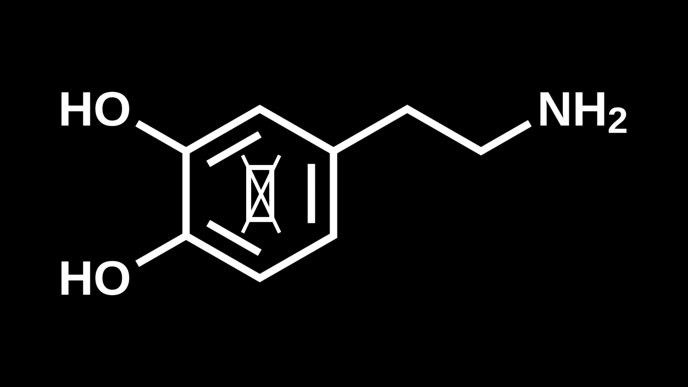

# Introducing BLACK DOPAMINE - My First Neural Language Model That I've Ever Made 



[](https://www.python.org/)
[](https://www.tensorflow.org/)
[](https://github.com/jovan-AIcoder)

## Disclaimer
**BLACK DOPAMINE** is a **LSTM language model** built from scratch using custom preprocessing pipelines and sequence tokenization. This project represents my first foundational milestone in exploration of Recurrent Neural Networks (RNN) and Natural Language Processing (NLP).

**This model is trained on an Indonesian-language text dataset from YouTube comments, so make sure that the prompt is in Indonesian [ID] language. The response is also in Indonesian [ID] language.**

> **⚠️WARNING: THIS MODEL IS BUILT FOR EDUCATIONAL AND EXPERIMENTAL PURPOSES ONLY, NOT INTENDED FOR PRODUCTIVITY OR AS A RELIABLE SOURCE OF SCIENTIFIC TRUTH. I'M NOT RESPONSIBLE IF THIS MODEL IS MISUSED. THE OUTPUT OF THE MODEL IS PURELY FROM STATISTICAL DISTRIBUTION OF THE TOKENS FROM THE DATASET, SO THIS MODEL CAN MAKE MISTAKES OR SAYING INAPPROPRIATE WORDS.**

---

## 📌 Features & Architecture
- **Architecture:** Long Short-Term Memory (LSTM) network designed for character/word-level language modeling.
- **Custom Tokenization:** Text cleaning (`clean_text()`), N-gram sequencing (`sequencing.py`), and special token handling (`<PAD>`, `<UNK>`, `<EOS>`).
- **Binary Serialization:** Optimized data handling with numerical representation exported via `.npy` files.
- **No Heavy Black-Box Frameworks:** Mathematical logic and optimization pipelines implemented with high transparency to build first-principles understanding.

---

## 🛡️ Ethical Considerations & Data Privacy

**BLACK DOPAMINE** uses public comments from YouTube videos collected via scraping (`fetch_comments.py`) for research, model design experiments, and educational purposes in machine learning. To maintain research integrity and respect user privacy:

1. **Anonymization & PII Protection:** No raw datasets, user metadata (such as usernames, profile links, or `user_id`), or original full-length comment threads are stored or published in this repository. 
2. **Vocabulary Artifacts (`vocab.json`):** The published vocabulary file contains isolated, single-word tokens extracted from the corpus. It DOES NOT contain Personally Identifiable Information (PII) and cannot be used to reconstruct original user messages or trace back to specific individuals.
3. **Platform Compliance:** Raw user data is strictly kept offline and unshared (it's also listed on `.gitignore`) to align with platform Terms of Service (ToS) regarding mass data redistribution. The binary files (`.npy`) that contains training dataset is also listed on `.gitignore` and kept unshared. Only derived technical artifacts and source code are included in this public repository.
4. **Scope of Usage:** This repository and its components are used purely for non-commercial research, academic exploration, and algorithm optimization.

---

## 🚀 Usage & Quick Start

1. **Clone the Repository:**
```bash
git clone https://github.com/jovan-AIcoder/black-dopamine
cd black-dopamine

```


2. **Setup Virtual Environment and System Requirements:**

For PowerShell:
```bash
python -m venv .venv
.venv\Scripts\Activate.ps1  
pip install -r requirements.txt
```


3. **Run Inference:**
```bash
python generate.py

```

## Output Example of `generate.py`

```plaintext

=== WELCOME TO BLACK DOPAMINE MODEL ===

Loading pre-trained model and metadata...
Model loaded successfully! Vocabulary size: 18143 tokens.

WARNING: This model is trained in INDONESIAN [ID] language. Please input prompt IN INDONESIAN [ID].

=== Interactive Prompt Generation Ready! ===
Type 'quit' or 'exit' to stop the execution.

Prompt > otak gw kena brain rot gara gara 
Temperature (default 0.7, recommended 0.2 - 1.2) > 0.2
Max Words to Generate (default 20) > 15

Generating text completion...

==================================================
Generated Output:
otak gw kena brain rot gara gara dihape benr dicontohin mantepppp kanvas sok2an 202528 depressed sampah2 tiktik aneka mobile dooming giliran novelty
==================================================

Prompt > bagi otak gw doomscrolling itu
Temperature (default 0.7, recommended 0.2 - 1.2) > 0.2
Max Words to Generate (default 20) > 15

Generating text completion...

==================================================
Generated Output:
bagi otak gw doomscrolling itu ajaga manajemen previllege singakatan nyetel sesuatunya identifikasi kewajiban very sepowerful propaganda pengangguran insomnia fact dijaman
==================================================

Prompt > brain rot gw parah banget sampai
Temperature (default 0.7, recommended 0.2 - 1.2) > 0.2
Max Words to Generate (default 20) > 15

Generating text completion...

==================================================
Generated Output:
brain rot gw parah banget sampai bkan sekalih sahabat modyar kebayang sempet kontradiksi ngapangapain scarltt ksn yasss badeni piknolepsi sehatt kebesaran
==================================================

Prompt > exit
Exiting BLACK DOPAMINE. Good luck!

```

> When I test out the model like above, I found that **BLACK DOPAMINE** exhibits behavior strikingly reminiscent of a chronic TikTok scroller after a 10+ hour doomscrolling binge. LSTM language models have **vanishing gradient problem**, so when the sequence length is made longer, the model will start with a coherent prompt, but gradually loses long-term context—yielding a stream-of-consciousness output filled with social media jargon, random typos, and fragmented thoughts. The other word is, **"The attention span of the model is very short."**

## Summary of the Dataset & Model Evaluation
This is the output of `summary.py`, and the output is:

```plaintext
============================================================
       BLACK DOPAMINE — MODEL & ARTIFACT SUMMARY       
============================================================

[1/4] Loading Model Architecture & Summary...
I0000 00:00:1793676145.830772   15476 cpu_feature_guard.cc:227] This TensorFlow binary is optimized to use available CPUinstructions in performance-critical operations.
To enable the following instructions: SSE3 SSE4.1 SSE4.2 AVX AVX2 AVX_VNNI FMA, in other operations, rebuild TensorFlow with the appropriate compiler flags.
WARNING:tensorflow:TensorFlow GPU support is not available on native Windows for TensorFlow >= 2.11. Even if CUDA/cuDNN are installed, GPU will not be used. Please use WSL2 or the TensorFlow-DirectML plugin.
------------------------------------------------------------
Model: "sequential"
┏━━━━━━━━━━━━━━━━━━━━━━━━━━━━━━━━━━━━━━┳━━━━━━━━━━━━━━━━━━━━━━━━━━━━━┳━━━━━━━━━━━━━━━━━┓
┃ Layer (type)                         ┃ Output Shape                ┃         Param # ┃
┡━━━━━━━━━━━━━━━━━━━━━━━━━━━━━━━━━━━━━━╇━━━━━━━━━━━━━━━━━━━━━━━━━━━━━╇━━━━━━━━━━━━━━━━━┩
│ embedding (Embedding)                │ (None, 29, 128)             │       2,322,304 │
├──────────────────────────────────────┼─────────────────────────────┼─────────────────┤
│ lstm (LSTM)                          │ (None, 29, 256)             │         394,240 │
├──────────────────────────────────────┼─────────────────────────────┼─────────────────┤
│ lstm_1 (LSTM)                        │ (None, 256)                 │         525,312 │
├──────────────────────────────────────┼─────────────────────────────┼─────────────────┤
│ dense (Dense)                        │ (None, 18143)               │       4,662,751 │
└──────────────────────────────────────┴─────────────────────────────┴─────────────────┘
 Total params: 23,713,823 (90.46 MB)
 Trainable params: 7,904,607 (30.15 MB)
 Non-trainable params: 0 (0.00 B)
 Optimizer params: 15,809,216 (60.31 MB)
------------------------------------------------------------

[2/4] Evaluating Model Performance...
E0000 00:00:1793676147.277389   15476 util.cc:131] oneDNN supports DT_BOOL only on platforms with AVX-512. Falling back to the default Eigen-based implementation if present.
511/511 ━━━━━━━━━━━━━━━━━━━━ 157s 305ms/step - accuracy: 0.3958 - loss: 3.1955
  • Test Loss     : 3.1955
  • Test Accuracy : 39.58%

[3/4] Fetching Execution Metadata...
----------------------------------------
  • embedding_dim        : 128
  • hidden_dim           : 256
  • num_layers           : 2
  • vocab_size           : 18143
  • max_seq_len          : 30
----------------------------------------

[4/4] Analyzing vocab.json Characteristics...
----------------------------------------
  • Total Vocab Size      : 18,143 tokens
  • Special Tokens        : ['<PAD>', '<UNK>', '<EOS>']
  • Average Word Length   : 7.20 characters
  • Longest Token         : 'wabarokaatuhalhamdulillahkatakanlah' (35 chars)
  • Shortest Token        : 'a' (1 chars)
----------------------------------------

============================================================
                SUMMARY PROCESS COMPLETED               
============================================================
```

## 🤝 Author

Developed by Jovan, 2026 (jovan-AIcoder). Licensed under MIT License.

Driven by a first-principles approach to computational physics and machine learning 🌌✨.


## 🛑 A Note for Developers

> *"To all developers out there: if you're going to build an AI model, build it in Python from first principles **like in this repo** rather than just using API wrappers—so the internet doesn't get poisoned by poisonous brain rot bots like this."*
> *— BLACK DOPAMINE Project Manifesto*
